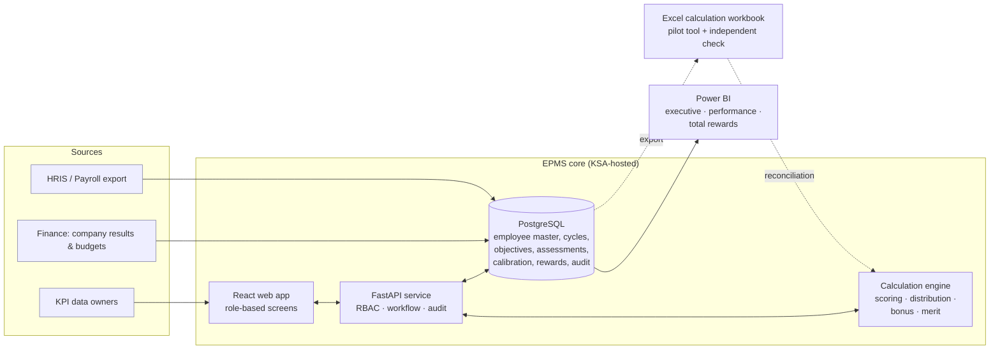

# Enerco Performance Management & Total Rewards System
## Phase 1: Research, Architecture and Design Specification

| Document control | |
|---|---|
| Document ID | EPMS-P1-SPEC |
| Version | 0.1 (submitted for Phase 1 review) |
| Owner | HR Department, Enerco |
| Prepared | November 2026 |
| Approval authority | HR Director (design); Authorized Executive Management (decisions marked **EXEC**) |
| Effective date | On Phase 1 approval |
| Review date | At each phase gate |
| Related documents | Decision Register, Assumptions Register, Phase 1 Review Questions (01_Strategy); Research Reference Library (02_Research); Saudi Compliance Review (16_Saudi_Compliance); Methodology Validation Report and Automated Test Run (19_Testing) |

---

## 1. Executive summary

Phase 1 sets the architecture and methods for every later phase. It also tests the approved design decisions against a working calculation engine on 120 synthetic employees. The engine is in `12_Web_Application/calc_engine` and passes 69 automated tests.

**The approved design holds up, with seven findings that management should see before build starts.** Two of them need a decision now.

| # | Finding | Impact | Decision |
|---|---|---|---|
| F-01 | Under the approved rating table, an employee who **exactly meets** every KPI target and is fully proficient on every competency scores 100.00, which is **"Exceeds Expectations"**. | Rating inflation built into the scale; bonus and merit cost rise accordingly. | **D-07 (needed now)** |
| F-02 | The approved table has gaps (for example 109.995 sits between 109.99 and 110). | Some scores would have no rating. | Resolved in design: round to 2 dp half-up, then use half-open bands. No approval needed. |
| F-03 | The company payout table is a step function: a company score of 79.99 pays 0.50 and 80.00 pays 0.75. | A 50% jump in the bonus pool for 0.01 points. This puts pressure on how the company scorecard is measured. | D-13: step or linear (both built) |
| F-04 | If ratings matched the 5/15/60/15/5 guideline, the average individual multiplier would be 0.9375. | At company factor 1.00, the bonus pool is about 94% of the target pool. Useful for Finance accruals. | Information |
| F-05 / F-06 | The illustrative merit matrix costs about **1.4% of eligible payroll** even at the guideline distribution, with the synthetic compa-ratio mix. That is well below a 2–4% budget. | The matrix percentages cannot be used as-is. They must be solved against the approved budget. | **D-16 (needed before Phase 7)** |
| F-07 | The stretch-target control (no score above 100 without an approved stretch) makes "Exceptional" rare unless stretch values are set at objective-setting. | Stretch setting becomes a mandatory step in the objective approval stage. | Built into the process |

Saudi compliance work found two high-priority legal items. Both need Legal sign-off before policies are written:

1. **The legal character of the annual bonus under the Labor Law's Article 2 wage definition.** It affects leaver rules and possibly end-of-service calculations.
2. **PDPL obligations for performance and pay data,** including the hosting location.

Official government sites could not be reached from the working environment. All legal references are therefore marked for verification against the official Arabic text.

---

## 2. Scope, principles and approved decisions

### 2.1 Scope
- **Version 1:** Enerco only, covering all departments, job families, grades, career levels (individual contributor, supervisor, manager, senior management), and Saudi and expatriate employees.
- **Built for later scale:** every record carries a `legal_entity_id`, so GetWater and IPTC can be added without changing the design (Section 4).

### 2.2 Design principles
1. **One calculation engine, one source of truth.** Every formula is implemented once (the Python engine) and reused by the web application. The Excel workbook implements the same formulas independently, and the two are reconciled employee by employee in testing.
2. **Parameters, not hard-coding.** Weights, bands, multipliers, matrices, thresholds and budgets are configuration that HR can change without changing a formula.
3. **Ratings are never changed to fit a curve or a budget.** Budgets are met through explicit, approved funding factors applied equally to everyone and recorded in the audit log.
4. **Preliminary is kept separate from final.** The preliminary score and rating are stored permanently next to the calibrated final rating and the reason for any change.
5. **Exceptions are flagged, not hidden.** For example, salaries above range maximum or unverified KPI evidence are routed to review.
6. **Least privilege.** Salary and performance data are visible only to roles that need them.
7. **Transparent and auditable.** Every number can be traced to its inputs, formula, configuration version and approver.

### 2.3 Approved decisions carried into the design
All approved decisions from the master brief are recorded in `Decision_Register.md` (D-01 to D-12) and applied throughout this document.

---

## 3. System architecture

| Layer | Pilot (cycle 1) | Target state |
|---|---|---|
| Employee master | Excel sheet from an HRIS export | PostgreSQL, synced from HRIS |
| Objectives and assessments | Web app (preferred) or Excel forms | Web app |
| Calculations | Python engine via web app; Excel used in parallel for reconciliation | Python engine |
| Calibration | Web app screens plus the committee pack exported from Power BI/Excel | Web app |
| Analytics | Power BI on the pilot database or the Excel extract | Power BI on PostgreSQL |
| Approvals and audit | Web app workflow and audit log | Same |

**Why both Excel and an application?** The brief asks for both. Excel is familiar to HR and Finance and is a strong pilot and verification tool. It is weak at access control, workflow and audit for confidential pay data at enterprise scale. The application provides those controls. Keeping two independent implementations of the same formulas, reconciled to the riyal, is also the best available evidence that the calculations are right.

---

## 4. Data architecture

### 4.1 Core entities

| Entity | Key fields | Notes |
|---|---|---|
| `legal_entity` | entity_id, name | ENERCO now; GETWATER, IPTC later |
| `org_unit` | org_unit_id, entity_id, parent_id, type (division/department/section), head_employee_id | Supports any depth |
| `job_family` | job_family_id, name, weighting_profile_id | Holds the approved weighting override, if any |
| `grade` | grade_id, entity_id, career_level, target_bonus_pct | Grade structure per entity |
| `salary_range` | grade_id, effective_from, min, mid, max, currency | Versioned by effective date |
| `employee` | employee_id, entity_id, org_unit_id, position, job_family_id, grade_id, manager_id, dept_head_id, employment_date, status, contract_type, nationality_group, bonus_eligible, merit_eligible | Master record; history kept as effective-dated rows |
| `compensation` | employee_id, effective_from, monthly_basic, fixed_allowances, approved_eligible_salary | Salary basis inputs; payroll-sourced |
| `cycle` | cycle_id, entity_id, year, start, end, status, config_version_id | One per entity per year |
| `config_version` | config_version_id, parameters (JSON), approved_by, approved_at | All parameters; immutable once a cycle is locked |
| `kpi_library` | kpi_id, name, definition, strategic_link, formula, unit, measure_type, data_source, frequency, owner_role | Reusable KPI definitions |
| `objective` / `kpi_assignment` | assignment_id, cycle_id, employee_id, kpi_id, weight, baseline, threshold, target, stretch, stretch_approved_by, evidence_required | Individual targets |
| `kpi_result` | assignment_id, period, actual, evidence_ref, verified_by, data_quality | Mid-year and year-end actuals |
| `target_change` | assignment_id, old/new values, reason, requested_by, approved_by | Controls mid-cycle changes |
| `competency` / `behavior` | id, type (core/functional/leadership/value), level descriptors 1–5 | Library |
| `assessment` | cycle_id, employee_id, assessor_role (self/manager/second-level), item_id, level, evidence, comment | Self, manager and second-level views stored separately |
| `score` | cycle_id, employee_id, kpi_score, competency_score, behavior_score, preliminary_score, preliminary_rating, engine_version | Written only by the engine |
| `calibration_case` | case_id, employee_id, original_rating, proposed_rating, reason, evidence, manager_justification, hr_review, committee_decision, final_approver | Stage 2 exceptions |
| `final_rating` | cycle_id, employee_id, final_rating, source (preliminary/calibrated), approved_by | |
| `company_scorecard` | cycle_id, component, measure, weight, target, actual, score, approved_by | Finance-owned |
| `bonus_calc` / `merit_calc` | cycle_id, employee_id, inputs snapshot, outputs, flags, status, approvals | Every run is stored with its config version |
| `approval` | object_type, object_id, step, approver_role, approver_id, decision, timestamp, comment | Configurable workflow |
| `audit_log` | event_id, timestamp, user_id, role, action, object, before, after, ip | Append-only |

### 4.2 Data protection rules
- Analytical tables and Power BI datasets use `employee_id`. Names are joined only in operational screens for authorised users.
- `nationality_group` is held for statutory reporting. It is excluded from calibration screens and comparison-group rules.
- Salary data is classified **Confidential – Restricted**. Performance data is **Confidential**.
- Retention periods are proposed in the Assumptions Register (A-20) for Legal approval.

---

## 5. Performance cycle design (summary)

Full process maps, SOPs and the complete RACI are Phase 2 deliverables. This table fixes the sequence, owners and approval points. The months assume a January–December cycle (A-01).

| # | Stage | When | Responsible | Approves | Key inputs → outputs | Escalation |
|---|---|---|---|---|---|---|
| 1 | Corporate objectives | Dec–Jan | Strategy / CEO office | Executive Management | Strategy → corporate scorecard and company scorecard targets | CEO |
| 2 | Department objectives | Jan | Department head | Executive in charge | Corporate objectives → department KPIs | HR Director |
| 3 | Individual objectives | Jan–Feb | Line manager with employee | Department head | Department KPIs → 3–8 individual KPIs | Department head |
| 4 | KPI assignment (baseline, threshold, target, **stretch**, weight, evidence) | Jan–Feb | Line manager | Department head; HR approves stretch values | KPI library → KPI assignments | HR BP |
| 5 | Objective approval and HR QA | by end Feb | HR BP | HR | Assignments → locked objectives; difficulty and baseline checks | HR Director |
| 6 | Continuous monitoring | Mar–Dec | Manager and employee | — | Actuals, evidence, check-ins | — |
| 7 | Mid-year review | Jun–Jul | Manager | Department head (target changes) | Progress → mid-year notes; approved target changes | HR BP |
| 8 | Self-assessment | early Jan (Y+1) | Employee | — | Results and evidence → self-ratings | Manager |
| 9 | Manager assessment | Jan | Line manager | — | Evidence → manager ratings and comments | Department head |
| 10 | Second-level review | Jan | Department head | — | Manager ratings → endorsed ratings | HR BP |
| 11 | HR quality assurance | Jan | HR | — | Engine flags (evidence, data quality, target changes) → QA log | HR Director |
| 12 | Calibration committee | late Jan | Committee | Committee chair | Preliminary ratings and distribution analytics → final ratings, decision log | HR Director → Executive |
| 13 | Final rating | Feb | HR | HR Director | Committee decisions → locked final ratings | — |
| 14 | Bonus calculation | Feb | HR Rewards | Finance validates | Final ratings, company factor → bonus file | CFO |
| 15 | Merit recommendations | Feb | Manager (within guideline) and HR | Department head → HR → Finance | Matrix and budget → merit file | CFO |
| 16 | Executive approval | Feb–Mar | Executive Management | Executive Management | Bonus and merit totals and exceptions → approved payouts | Board, if required |
| 17 | Employee feedback | Mar | Line manager | — | Final outcome → feedback conversation record | HR BP |
| 18 | Development planning | Mar | Manager with employee | — | Gaps → IDP; PIP where needed | HR BP |

---

## 6. Performance scoring methodology

### 6.1 One scale for every component
All three components use a **0–120 scale on which 100 means "fully meets the standard".** Weighting is therefore mathematically consistent:

> **Preliminary Score = KPI Score × 70% + Competency Score × 20% + Behavior Score × 10%**
> Each component ranges 0–120, so the preliminary score ranges 0–120.

Approved job-family weighting profiles (D-05) replace the 70/20/10 split only for that family. The configuration check rejects any profile that does not sum to 100%.

### 6.2 KPI scoring curve
Each KPI is scored by straight-line interpolation between points agreed at objective-setting:

| Point | Score | Set by |
|---|---|---|
| Floor | 0 | Default = threshold − (target − threshold); can be overridden |
| Threshold (minimum acceptable) | 70 | Manager, checked by HR |
| Target (full expectation) | 100 | Manager, approved by department head |
| Stretch (exceptional) | 120 | Manager, **approved by HR** |

- **Higher-is-better** (revenue, output, productivity): the points increase.
- **Lower-is-better** (cost, incident rate, cycle time): the engine mirrors the axis, so the same curve applies.
- **Binary** (done / not done): 100 or 0. It cannot exceed 100.
- **Milestone / project completion:** actual = share of milestones delivered on time, scored on the same curve (for example threshold 70%, target 100%).
- Financial, quality, productivity, operational efficiency and project KPIs are **categories**. Each is assigned one of the four measure types above.

KPI component score = Σ (KPI weight × KPI score). Weights must total 100%. Rules: 3–8 KPIs per employee, each weighted 5–40% (A-05).

### 6.3 Controls against inflated KPI scores
The brief requires that nobody receives a high score merely because a target was set wrongly. The engine enforces:

| Control | Rule | Engine behaviour (tested) |
|---|---|---|
| Stretch approval | No score above 100 unless an HR-approved stretch value exists | Capped at 100; flag `CAPPED_NO_APPROVED_STRETCH` |
| Target difficulty | Target must be harder than the baseline (prior actual) | Flag `TARGET_NOT_ABOVE_BASELINE` for HR QA |
| Design validity | Threshold below target (higher-is-better), above target (lower-is-better); stretch beyond target | KPI rejected until corrected |
| Evidence | Without verified evidence, the score cannot exceed 100 | Capped at 100; flag `EVIDENCE_NOT_VERIFIED` |
| Data quality | Unreliable data source | Capped at 100; flag `DATA_QUALITY_UNRELIABLE` |
| Target changes | Mid-cycle changes need department-head approval and are logged | Unapproved change caps at 100; flag `UNAPPROVED_TARGET_CHANGE` |

### 6.4 Competencies and behaviors
- **Library:** core competencies (all staff), functional competencies (by job family), leadership competencies (supervisors and above), and corporate values/behaviors. The full library with observable indicators is a Phase 3 deliverable.
- **Five proficiency levels** mapped onto the common scale (A-06):

| Level | Descriptor | Score |
|---|---|---|
| 5 | Role model: consistently exceeds, coaches others | 120 |
| 4 | Advanced: frequently exceeds | 110 |
| 3 | Proficient: fully meets the standard | 100 |
| 2 | Developing: partially meets | 80 |
| 1 | Not demonstrated | 60 |

- **No double counting.** KPIs measure *what* was achieved and competencies measure *how* it was achieved. Assessment forms state that a competency rating may not cite a KPI result as its evidence. Instead, competency evidence must describe observed behavior. HR QA checks a sample of forms.

### 6.5 Rating scale: decision D-07 required

**The issue (Finding F-01).** On the common scale, 100 means "fully meets". In the approved table, 100.00 is the lower bound of **Exceeds Expectations**. An employee who fully meets every expectation is therefore rated "Exceeds". The 120-employee simulation shows this at population level: under the approved bands, 29% of employees are rated "Exceeds", against a 15% guideline.

| Option | Bands (score after rounding) | Pros | Cons |
|---|---|---|---|
| **A: recentre (recommended)** | 5: ≥115 · 4: 105–<115 · 3: 90–<105 · 2: 75–<90 · 1: <75 | "Meets" contains 100. Each competency level falls inside its own band (L2 = 80 → 2, L3 = 100 → 3, L4 = 110 → 4, L5 = 120 → 5). | Changes the approved band numbers |
| B: keep approved bands | 5: ≥110 · 4: 100–<110 · 3: 85–<100 · 2: 70–<85 · 1: <70 | No change to the approved table | Meeting every target = "Exceeds". Higher bonus and merit cost. Managers will see "Meets" as below target. |
| C: keep bands, move the target point to 92.5 | Approved bands; KPI target scores 92.5, level 3 = 92.5 | Keeps the table | Hard to explain ("hitting target scores 92.5"). Breaks the "100 = target" logic. |

Both A and B are fully configured in the engine. Changing the choice is one configuration change.

**Boundary rule (resolves Finding F-02):** the preliminary score is rounded to 2 decimals (half-up) and then banded with inclusive lower bounds. Every possible score maps to exactly one rating. This was tested on all 12,001 values from 0.00 to 120.00.

### 6.6 Preliminary score vs. final rating
The engine writes the preliminary score and rating. Only the calibration process (Section 7) can create a different final rating, and it must record the reason, the evidence and the approver. Both values are kept permanently, and rewards always use the **final** rating.

---

## 7. Hybrid bell curve and calibration methodology

### 7.1 Stage 1: guided distribution analytics
For each comparison group, the system shows actual count and %, guideline %, variance in percentage points, and a **statistically expected range**. The expected range is the 90% binomial interval for the group size. Views: company, department, job family, grade/career level, and manager.

A rating category is **flagged** only when its count is outside the expected range **and** the group is large enough. Being under or over the guideline by a few people in a small team is normal variation, not a finding.

| Group size | Treatment |
|---|---|
| ≥ 20 | Full comparison; flags raised |
| 10–19 | Indicative only; shown without flags |
| < 10 | Too small; qualitative review only. The group is pooled with similar groups (same job family and career level) for analytics. |

Evidence for this rule (calculated): in a team of 20 with a 5% guideline, there is a **35.8%** chance that nobody is "Exceptional" by chance alone. In a team of 10 it is 59.9%. Forcing every team to fill every category would therefore create unfair ratings. The approach is also supported by research showing that individual performance is often not normally distributed (R-10) and that forced distribution has limited, fading benefit (R-12).

### 7.2 Comparison groups
Configurable rules select the grouping used for calibration. The default order is: job family + career level within the entity → career level within division → whole entity. A group is used only if it reaches the minimum size; otherwise the next broader rule applies. Nationality, gender and age are never grouping criteria.

### 7.3 Stage 2: controlled exceptions
Any final rating that differs from the preliminary rating is a **calibration case** with these fields: original rating, proposed rating, reason code, supporting evidence, manager justification, HR review, committee decision, and final approver. The system:
- never moves an employee down to meet the curve. A downgrade needs a documented performance reason, such as evidence that the scoring overstated performance.
- requires stronger evidence for moving into ratings 5 and 1.
- recalculates bonus and merit automatically from the final rating. This was tested: only the calibrated employee's outcomes changed.

### 7.4 Calibration committee
The charter, agenda, review template, decision log, exception form and report are Phase 5 deliverables. The proposed composition (A-09) is the HR Director (chair), department heads in the comparison group, an HR Business Partner (secretary), and an independent senior manager from another function. The committee's mandate is to challenge unsupported high **and** low ratings, compare managers' rating patterns, and record every decision.

---

## 8. Annual bonus methodology

### 8.1 Formula (approved)
> **Annual Bonus = Eligible Annual Salary × Target Bonus % × Company Performance Factor × Individual Performance Multiplier × Eligibility Proration**

| Element | Design |
|---|---|
| Eligible annual salary | Configurable basis: annual basic (default), annual fixed, approved eligible salary, or a fixed target amount. Allowances are excluded unless that basis is chosen. |
| Target bonus % | By grade, in the Job Grades table. The synthetic values are illustrative only (A-12). |
| Company performance factor | From the company scorecard: financial 50%, operational 30%, strategic 20%, each scored 0–120, then the payout table. |
| Individual multiplier | 5: 1.50 · 4: 1.25 · 3: 1.00 · 2: 0.50 · 1: 0.00 (proposed, configurable) |
| Proration | Eligible days in cycle ÷ days in cycle, net of unpaid leave. Minimum service of 90 days is proposed (A-11). |

### 8.2 Company payout factor: step or linear (D-13)
The proposed step table (Finding F-03) is implemented, and so is a linear option that interpolates between the same points. For example, at a company score of 75 the step table pays 0.50 and the linear option pays 0.625. Linear reduces disputes about decimal points in the scorecard. Step is simpler to communicate. **Recommendation:** linear between 70 and 110, with 0 below 70 and a 1.20 cap.

### 8.3 Eligibility rules (all flagged for legal validation)
| Case | Proposed default (A-11) | Legal check |
|---|---|---|
| New joiner | Prorated from joining date; 0 if under 90 days in the cycle | Yes |
| Resignation before payment | Engine calculates and flags; policy decision pending | **Yes, Article 2 wage character** |
| Termination | As above | **Yes** |
| Internal transfer | Single bonus using the final rating; salary basis at cycle end | Policy |
| Promotion | Salary basis at cycle end; target % of the new grade from the promotion date (time-weighted) | Policy |
| Unpaid leave | Excluded from eligible days | Yes |
| Contractually not eligible | 0, with reason recorded | Contract review |

### 8.4 Budget controls
The system tracks total available budget, calculated liability, proposed payout, approved payout, remaining budget, utilisation %, and variance. If liability exceeds budget, the system shows the uniform **funding factor** (budget ÷ liability) that would apply to everyone. Applying it is an executive decision recorded in the audit log. **Ratings are never changed to meet the budget.**

Planning figure (Finding F-04): if final ratings match the guideline, payout ≈ target pool × company factor × 0.9375.

---

## 9. Merit increase methodology

### 9.1 Compa-ratio
> **Compa-Ratio = Current Base Salary ÷ Salary Range Midpoint × 100**

The analytical bands are <80, 80–89.99, 90–99.99, 100–109.99 and 110+. These are positioning bands, not market standards.

### 9.2 Matrix (illustrative; for simulation only)
The approved illustrative matrix is configured exactly as given in the brief. **These percentages are not approved salary increases.**

### 9.3 Budget calibration (Finding F-06, decision D-16)
The matrix percentages must be solved against the approved budget. Two methods are built:
1. **Uniform scaling:** multiply every cell by budget ÷ projected matrix cost. This keeps the matrix shape. For example, the synthetic population needs ×2.90 to reach 3%.
2. **Cell redesign:** HR edits the cells and the simulator recalculates cost by grade, department and rating until it fits.

Recommendation: first confirm the matrix **shape**, then solve the level using the projected rating mix from the calibrated ratings. Run the simulations at 2%, 3%, 4% and a custom value.

### 9.4 Controls
| Control | Rule |
|---|---|
| Min/max | Every increase is clamped to the configured minimum and maximum (default 0–10%). |
| Range maximum | If the new salary would exceed range max, the case is **flagged `REVIEW_EXCEEDS_RANGE_MAX` and not truncated**. HR, Finance and Executive decide: approve, cap, or pay a lump sum (A-17). |
| At or above max | Flagged `REVIEW_AT_OR_ABOVE_RANGE_MAX`. |
| Below range min | Flagged for a separate equity-adjustment review. Merit is not used to fix structural underpayment. |
| Promotions and market adjustments | Handled as separate transactions with their own budget lines and **excluded** from merit cost. |
| Eligibility | Joined on or after the cut-off date (A-16), leavers, and contractually ineligible employees receive 0 with a reason. |
| Discretion | Managers may recommend within ±1 percentage point of the matrix value (D-17, proposed). Larger deviations need HR and Finance approval. |
| Outputs | New salary, new compa-ratio, cost by grade, department and rating, and counts of employees with and without increases. |

---

## 10. Governance

### 10.1 Approval workflow (configurable)
Line Manager → Department Head → HR Review → Calibration Committee → Finance Validation → Executive Approval

### 10.2 Approval matrix (summary; full matrix in Phase 11)
| Item | Recommends | Reviews | Approves |
|---|---|---|---|
| Individual objectives and KPIs | Line manager | HR BP (QA) | Department head |
| Stretch values | Line manager | HR | HR Director |
| Mid-cycle target change | Line manager | HR BP | Department head |
| Performance rating | Line manager | Department head, HR | Calibration committee |
| Rating exception (stage 2) | Line manager / committee member | HR | Committee chair; ratings 1 and 5 also need the HR Director |
| Company scorecard result | Finance | Internal audit (proposed) | Executive Management |
| Bonus payouts | HR Rewards | Finance | Executive Management |
| Merit increases | Line manager | Department head, HR, Finance | Executive Management |
| Budgets and funding factors | Finance | HR | Executive Management |
| Policy exceptions | HR | Legal | Executive Management |
| Configuration changes | HR Rewards | HR Director | HR Director; Finance co-approves financial parameters |

### 10.3 Audit trail
An append-only log records every create, change and approval with user, role, time, before and after values, and reason. A cycle's configuration version is locked once assessments open.

---

## 11. Access control (RBAC)

| Data / action | Employee | Line Manager | Dept Head | HR Admin | Finance | Committee | Executive |
|---|---|---|---|---|---|---|---|
| Own objectives, ratings, outcomes | ✔ | — | — | ✔ | — | — | — |
| Team objectives and assessments | — | Direct reports | Department | All | — | Groups under review | Summary |
| Preliminary scores and distribution | — | Own team | Department | All | — | Groups under review | Summary |
| Individual salary | Own | Direct reports (merit step only) | Department (merit step only) | All | All | — | Summary or by exception |
| Bonus and merit amounts | Own (after approval) | Direct reports | Department | All | All | — | All |
| Configuration | — | — | — | Edit (Rewards) | Co-approve financial values | — | — |
| Audit log | — | — | — | Read | Read (financial) | — | — |

Analysts and Power BI users see only employee IDs unless their role grants operational access.

---

## 12. Technology architecture

| Component | Choice | Rationale |
|---|---|---|
| Frontend | React + TypeScript | As suggested in the brief; strong typing for complex forms |
| Backend | Python FastAPI | Reuses the validated Python engine directly |
| Database | PostgreSQL | Relational integrity, row-level security for entity separation |
| Authentication | Enterprise SSO (Microsoft Entra ID, if Enerco uses Microsoft 365) with MFA | No separate passwords; joiners and leavers handled centrally (A-21) |
| Authorization | Role and scope checks at the API layer, plus database row-level security per legal entity | Defence in depth |
| Hosting | Inside Saudi Arabia: on-premises or a KSA cloud region | PDPL transfer rules; proposed data-localisation amendments |
| Reporting | Power BI (direct or import) with row-level security | As per the brief |
| Excel | Built with openpyxl, formulas native to Excel, protected sheets | Pilot and independent check |
| Environments | Development (synthetic data only), test, production | Real data only in production, after authorisation |

**Not done in Phase 1:** nothing has been deployed, and no real employee data has been used.

---

## 13. Quality assurance strategy

1. **Unit tests on the engine.** 69 tests pass today, covering KPI curves, weights, boundaries, distribution, company factor, bonus, merit and calibration (see `19_Testing/Phase1_Automated_Test_Run.md`).
2. **Independent reconciliation.** Excel and the engine are run on the same 100+ synthetic employees, and every output is compared to the riyal (Phase 8/12).
3. **Scenario tests.** Company outcomes (below threshold, on plan, strong) and merit budgets (2%, 3%, 4%, custom).
4. **Access tests.** Each role is tested against the RBAC matrix (Phase 10/12).
5. **Audit tests.** Every approval and change appears in the log with before and after values.
6. **User acceptance testing** with HR, Finance and two pilot departments (Phase 13).

---

## 14. Implementation plan

| Phase | Main deliverables | Indicative duration | Gate |
|---|---|---|---|
| 1 Research and architecture | This pack | Done | **Phase 1 approval** |
| 2 Performance framework | Process maps, 18 SOPs, RACI | 2 weeks | HR Director |
| 3 KPI and competency library | KPI library by department, competency framework with indicators | 3 weeks (needs department input) | HR Director + department heads |
| 4 Rating and scoring engine | Final band choice, scoring guidelines, forms | 1 week | HR Director |
| 5 Bell curve and calibration | Charter, templates, analytics spec | 1 week | HR Director |
| 6 Bonus engine | Bonus policy draft, methodology, calculator | 1 week | Finance + Legal |
| 7 Merit engine | Merit policy draft, matrix solved to budget, simulator | 1 week | Finance |
| 8 Excel development | 28-sheet workbook | 2 weeks | HR + Finance |
| 9 Power BI | Data model, DAX, three dashboards | 2 weeks | HR Director |
| 10 Web application | Secure application with all modules | 6–8 weeks | IT Security + HR |
| 11 Policy and governance | 22 policies, forms and guides | 2 weeks (in parallel) | Legal + Executive |
| 12 Testing and QA | Test report, reconciliation, UAT | 2 weeks | QA sign-off |
| 13 Pilot | Controlled pilot (2–3 departments), lessons log | One mid-year or year-end cycle | Executive |
| 14 Executive presentation | Final deck | 1 week | Executive Management |

Phases 2–9 and 11 can overlap. The critical path is the KPI library (department input), then the web application, then the pilot. **For the 2026 year-end cycle** (January–March 2027), a realistic pilot uses the Excel workbook and Power BI, with the web application in parallel. Applying the full system to 2027 objective-setting is the realistic first full cycle (A-22).

---

## 15. Decisions requested at this gate

| ID | Decision | Recommendation | Needed by |
|---|---|---|---|
| **D-07** | Rating band alignment (Section 6.5) | Option A | Phase 4 (blocks Excel and app build) |
| D-13 | Company payout: step or linear | Linear | Phase 6 |
| **D-16** | Merit matrix: shape, then solve to the approved budget | Approve the shape; solve the level in Phase 7 | Phase 7 |
| D-17 | Manager discretion on merit (±1 pp) | Approve | Phase 7 |
| D-18 | Pilot scope and timing | Excel and Power BI pilot on the 2026 year-end; full system for the 2027 cycle | Phase 13 planning |

Detailed lists: `Decision_Register.md`, `Assumptions_Register.md`, `Phase1_Review_Questions.md`.
